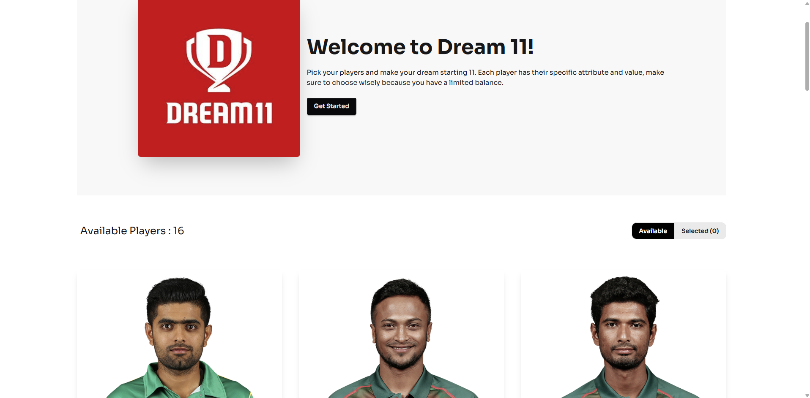

# Project Name

## 🔗 Live Link
[Live Project Link](https://mybpl-dream-11.netlify.app/)

---

## 📖 Project Overview
This project is a frontend single page web application built by react.
The project focuses on responsive UI, clean design, and interactive functionality.

---

## Screenshot


---

##  Technologies Used
- HTML
- CSS
- JavaScript
- React
- Tailwind CSS

---

##  Core Features
- Dynamic data rendering
- User-friendly UI
- Clean and structured code

---

##  Dependencies
- react
- tailwindcss
- react-toastify

---

##  How to Run Locally

```bash
git clone https://github.com/your-username/project-name.git
cd project-name
npm install
npm run dev
